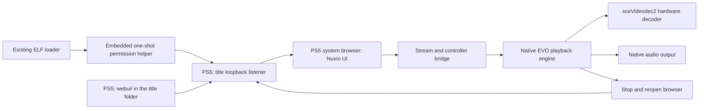

# Architecture

## Component boundaries

[SOURCE-VERIFIED] The port uses the source revisions in [Sources](SOURCES.md).
The console runs an EVO-derived native title with the identity `PPSA99996`. The
browser UI travels inside the title folder. The title loads its embedded
permission helper through the existing ELF loader and serves the UI over loopback.

The browser and the native player have separate lifetimes. The title closes the
browser before it starts native playback and opens it again when playback ends.
The Nuvio route state supplies a previous page for the new browser session. The
port never runs a browser inside the native decoder.

## Source changes

| Area | Change | Reason |
|---|---|---|
| Title metadata | Assign the Nuvio name and `PPSA99996` | Keep the install separate from EVO and the upstream port |
| Data paths | Use `/data/nuvio` | Keep settings separate from EVO |
| Startup | Open the configured Nuvio provider automatically | Start in Nuvio browsing |
| Browser layout | Use the full browser area | Remove the EVO navigation rail beside Nuvio |
| Controller bridge | Direct X to the focused Nuvio element | Avoid activation at the fixed browser pointer |
| Seek request | Accept an active provider demuxer without a local history path | Support seeks in provider streams |
| Seek state | Announce only accepted seek requests | A rejected request must not leave playback in seeking |
| Network reader | Use FFmpeg HTTP range reads and bounded retries | Avoid parallel connection storms after provider seeks |
| Native loading screen | Draw Nuvio branding during automatic transitions | Hide the EVO menus during those transitions |
| Playback exit | Stop Nuvio playback on Circle | Return without the hidden native confirmation |
| Playback overlays | Keep active playback screens visible | Preserve native controls and dialogs |
| Route state | Enable the Nuvio resume methods for the PS5 flag | Keep browsing state across browser recreation |
| Public browser configuration | Read selected login and metadata values from the pinned official TV package | Enable QR login, TMDB metadata and Trakt catalogue requests |
| Browser UI hosting | Serve `webui/` from the title over loopback | Remove the computer that served the UI |
| Host build | Select Linux or macOS toolchains and host zlib | Build the same PS5 sources on either host |

`sce_sys/param.json` in this repository holds the title identity and content
version. The build copies those values into the generated title, so a release tag
carries the metadata a store needs.
It also copies category `0` and badge `1` for Games classification and home-screen selection music.
The old upstream identity is `PPSA99997`. Historical evidence retains that identity.

`scripts/build.py` and `scripts/polish.py` apply these changes. The generated
patches show changes to upstream files. The adapters also copy the loading
artwork and the RML assets. The patches alone do not perform the full build.

The browser UI uses Nuvio TV 1.4.1. EVO remains pinned to v0.13.5 with the existing native patches.
Upstream now supplies nullable collection-rating normalization, manual source selection and series-wide stream preference lookup.
PS5 adapters retain focused stream identity during incremental loading and defer preference writes until native playback succeeds.
The adapters disable the new stream-link cache on PS5. Stream reuse still matches fresh addon results instead of storing signed URLs or headers.
Onboarding keys pass through the existing focus engine once. Layout Back returns to experience selection.

`scripts/native_skin.py` applies Nuvio's 1.3.11 player palette, bottom metadata and timeline to the native homebrew-ui renderer and RML fallback.
It preserves native controller actions, playback state, subtitle styles, skip prompts, next-episode policy and clock visibility.
The subtitle picker distinguishes the selected track from controller focus. Native menu navigation remains EVO's model, not the web player's model.
Captions move above the taller controls while the controls are visible. Native library and settings themes remain unchanged.

## Controller and screen state

The PS5 browser sends X as a click at its stationary pointer. Nuvio moves its own
focus with the D-pad. `scripts/ps5-input.js` forwards primary activation to
`scripts/ps5-navigation.js`, which uses the pinned frontend's Enter handlers.
The adapter chooses the current modal or screen before activation.
It blocks background activation during modal transitions and preserves text-field focus and click handling.
A recursion guard prevents duplicate activation.

The existing native pad reader forwards Options and Triangle edges while the browser is active.
The adapter polls counters through the title's `/evo/controller` endpoint.
Either analog stick also supplies directional navigation through this bridge while the browser is active.
The adapter selects the dominant axis beyond the existing approximately 55% tilt threshold and reuses EVO's directional repeat policy.
The left stick takes priority if both sticks move. Diagonals produce one direction, not two.
The frontend converts each new navigation report into standard arrow-key events for the current modal or screen.
It coalesces delayed repeats and discards stale reports after backgrounding or connection failure.
Physical D-pad events remain browser-owned. Native player and keyboard controls retain their existing stick behavior.
Options calls the focused item's existing context-menu method.
Triangle opens the existing Search screen and focuses its real text box within the browser key event.
On PS5, Search paints before awaiting profile decoration. Background result refreshes preserve an active text box.
Search now uses a controller-operated `NuvioDialog` keyboard. Its readonly textbox suppresses browser text entry while the dialog edits a local draft.
The Search-only native IME endpoint and browser-close state machine are removed. Other native keyboards remain unchanged.
The grid has four ten-key rows and six actions: Space, Delete, Clear, Shift, Search and Cancel.
Physical character keys and Backspace also edit the draft. Deletion removes complete Unicode code points, with a 255-code-point query limit.
Action keys display local SVG adaptations of the pinned homebrew-ui controller glyphs used by EVO's native renderer.
They retain its colored face symbols, dark button discs, L3 stick badge and shaped R2 trigger, with source attribution beside the SVG code.
Triangle inserts Space and Square deletes through the observed browser F1/F2 events. L1, R1, L2 and R2 use owner-ordered firmware 12.70 browser events F5, F6, F7 and F8. Native counters remain the fallback.
L1/R1 move the visible text caret through Unicode code points. Typing inserts there, and Delete removes the preceding code point.
Insertion at the query limit preserves the suffix and caret. Clear and suggestion completion reset the caret to the new query's end.
The adapter uses existing `PadButtons::L1`, `R1`, `L3` and `R2` declarations, not guessed browser shoulder keycodes.
Native screenshot capture leaves browser L3 available to this bridge. Native L3 capture and R3 behavior remain unchanged outside that exclusion.
Triangle's browser event stops at the keyboard. Native Search notifications cannot navigate or reopen Search while a dialog is active.
Keyboard listeners exist only while the dialog is open. The controller poll discards stale counters after reconnect or backgrounding.
Suggestions show up to four matching recent searches and addon titles. Selection completes the draft and focuses Search without submitting it.
After two characters and a 400 ms debounce, lookups use the existing catalogue repository and searchable-addon contract.
Each lookup selects at most one movie and one series catalogue. If neither type exists, it uses at most two other searchable catalogues.
Requests have a 2.5-second abort timer. Query changes and keyboard closure cancel outstanding requests, and generation checks reject stale replies.
Suggestions deduplicate titles without case sensitivity and respect Hide unreleased content. Failures leave manual Search available, with recent matches retained.
Accepted text uses Search's normal submit path and focuses results. Cancellation keeps the original query.
Removed inputs and stale routes cannot submit the draft. Editing needs no native IME. Live suggestions use existing addons, not a new search provider.
Search mount requests input except during back navigation. Triangle and textbox activation remain explicit input requests.
Returning from result details preserves Search without opening the keyboard. Merely focusing or rerendering the textbox does not reopen it.
Detail Back pops an existing Search history entry instead of leaving a duplicate Search predecessor that blocks the next Back.
There is no typing timeout or one-shot limit. Search without a history predecessor sends Back to Home after dismissing actions.
The keyboard passes host browser checks. Actual PS5 key mapping, IME suppression and repeated entry remain pending console validation.
The adapter leaves undocumented browser IME pointers and control bits unchanged.
Search uses local SVGs for Discover, empty-state search and recent-history removal, without a remote icon font.
The controller menu remains an item-action fallback containing Player settings and Display diagnostics.
Display diagnostics reads the CSS viewport, pixel ratio, screen dimensions and visual viewport without changing settings or writing logs.
Viewport multiplied by DPR is an estimate, not proof of the internal browser surface or HDMI output resolution.
The detail page also exposes a D-pad-reachable Play options button.
Settings > Playback exposes Player settings without a pointer.
These native button paths still require console validation while the system browser owns the controller.
The owner's 12.70 browser reports Square as F2/113 and Options as F3/114.
The newest key after an isolated Triangle test is F1/112. The adapter handles that observed shortcut too.
Square and Options use the existing item-menu path, without waiting for native counters.
No guessed browser event or Gamepad mapping supplies these buttons.

The title's stylesheet requests a hidden cursor.
This does not establish whether the system browser hides its own pointer overlay.
The adapter leaves D-pad, Circle, text entry and native playback controls with their existing owners.
On PS5, Up and Down move between a settings text field and its action buttons.
The console keyboard's actual behavior remains a hardware check.

The Nuvio build sets `window.__NUVIO_PS5__`, and the router uses that flag for its
route resume methods. The flag preserves the previous browsing route when playback starts.
The native handoff saves a one-use profile and route snapshot and marks its return URL.
Startup restores that profile and page when the native player reopens the browser.
Title and stream pages can resume on PS5. Ordinary launches retain profile selection.
The return check rejects changed, deleted or expired profile snapshots.
Playback return restores stream selection with the existing manual-selection override.
For restored title details, it removes the one-use Play and Continue Watching triggers.
This prevents browser recreation from starting the same video again.
The saved autoplay setting stays unchanged, so a fresh Play action can still select the first stream.
It does not enable the webOS services.

The player handoff reads the live route's resume timestamp, not browser history.
Start over uses zero. Percentage-only progress requires a saved duration.
EVO receives the offset through its existing startup-seek path.
Unknown duration or a rejected demuxer seek can still prevent startup resume.

The AGC playback bridge prefers the homebrew-ui HUD when that renderer can draw the current captions.
RmlUi remains the fallback for unsupported caption glyphs.
Both HUDs must consume the skip, next-episode and playback-ended fields.
Homebrew-ui copies the skip label before drawing, independent of the input string's lifetime.
The prompt cards remain outside the fading controls, including when those controls are hidden.
Host RmlUi renders alone do not validate the preferred console HUD.

Before browser closure, the frontend saves an opaque session ID with the originating profile and PlayerController's progress context.
EVO samples position and duration during playback and immediately before native teardown.
Both sampling paths skip uncommitted scrub previews and retain the last measured position instead.
Its console-local `/evo/progress` endpoint exposes only the matching session's finished report.
On return, the frontend verifies the saved profile and session before rendering the restored route.
PlayerController's existing progress writer saves the movie or exact episode and applies its normal 90% watched threshold.
Failed starts without a positive position cannot erase saved progress.
Pending imports retain their return identity until success or a terminal missing report, allowing retries after transport or writer failures.
An active seek to zero invalidates an older positive sample. Teardown's zero duration does not replace a valid sample.
The existing HTTP accept thread checkpoints changed samples every 30 seconds, without disk work on the playback thread.
The first measured sample and a finished report request an earlier checkpoint.
Two small, checksummed files beside the browser snapshot alternate synchronous writes. Failed writes leave the preceding slot intact.
After a forced close or restart, `/evo/progress` can recover the newest intact matching session.
Nuvio imports it after the originating profile becomes active, including after normal profile or PIN selection on a cold launch.
Recovery does not need the playback-return URL or its route lifetime. It does not bypass profile selection or restart playback automatically.
Successful imports clear the pending browser context. Missing or damaged checkpoints cannot supply another session's progress.
Healthy checkpoints normally limit lost progress to approximately 30 seconds plus scheduling delay.
Storage failures or a damaged latest slot can require an older position. Console power-loss durability and playback performance remain unverified.
This bridge does not implement live Trakt or Simkl scrobbling.

Before native handoff, Nuvio uses its existing IntroDB repository and playback identity to fetch intro, recap and credits intervals.
Lookup respects the active profile's Skip Intro setting and has a four-second deadline.
Failure or missing data starts playback without prompts. A changed route, selection or profile cancels the stale handoff.
Only bounded timestamp records enter EVO. No metadata lookup runs during native playback.
The native overlay shows Skip intro, Skip recap or Skip credits while measured playback lies inside a valid interval.
R1 seeks to the supplied segment end. Outside a prompt, R1 retains chapter navigation and X retains pause.
Prompts remain visible after controls fade. Scrubbing, buffering, live streams, music and the diagnostics overlay suppress them.
The "Dims in" countdown keeps a newly shown prompt at full opacity for ten seconds of unpaused display time.
At zero, the countdown text disappears and the prompt dims to 50% opacity. R1 remains available through the segment.
Newly shown intervals and native handoffs reset the countdown. Countdown expiry never initiates a seek.
Known post-credit scenes remain reachable through Nuvio's existing target-selection rules.
The handoff marks each interval using the active profile's individual auto-skip settings.
EVO automatically seeks through enabled types during ready, unpaused playback. Other types keep their manual prompts.
Outro aliases share the outro setting. Movie credits retain their independent setting before both use the native credits label.
The Skip Intro master switch disables both modes. Settings apply at handoff because the browser closes during native playback.
The player rejects malformed intervals and targets beyond the current duration. It clears intervals between native handoffs.
A five-second suppression window hides stale pre-seek samples while allowing another attempt after a failed seek.
These host-checked paths still require console validation. Timestamps cannot establish that the stream uses the matching cut.

The storage hook rejects failed or incomplete reads rather than saving an empty or partial snapshot.
It tracks explicit Storage API removals so sign-out and reset can still delete saved keys.
Restore or tracking failure disables saves for that document, preserving the disk copy.
Serialized synchronous loopback POSTs advance the baseline only after acknowledgement. This avoids asynchronous write reordering but can block the browser.
Teardown rejection can lose recent unsaved changes. Native file writes remain in-place, not crash-safe or transactional.

Native next episode captures episode metadata and normalized playback policy before browser closure, without copying the current stream URL.
EVO displays a three-second autoplay countdown or a manual next-episode prompt at Nuvio's configured threshold.
Known credits can advance that threshold, except when their post-credit gap exceeds the user's threshold.
Pause, buffering, scrubbing and hidden playback screens freeze the countdown. L1 cancels the transition for that title session.
R1 skips an eligible intro or credits segment first, starts a visible next-episode action second, and otherwise retains chapter navigation.
The still-watching limit disables automatic transitions until the user chooses the manual action.
The finished progress report carries a live-only transition request. Recovery checkpoints never contain launch intent.
After importing progress through the existing profile gate, startup consumes an in-memory, one-use route authorization.
The player then calls Nuvio's existing next-episode resolver and stream-selection policy, without starting the preceding stream or another countdown.
Manual selection or a missing automatic match opens Nuvio's existing episode stream picker.
No per-frame network request or filesystem write enters the next-episode path.

### Playback General presentation

Before browser closure, a separate recommendation controller prepares bounded text through Nuvio's existing metadata, source and watched-title filters.
It does not run the browser controller's trailer or playback pipeline.
Parental warnings, pause metadata and recommendation preparation share a four-second deadline with skip lookup.
Late results cannot change the captured session. Missing data leaves the corresponding card absent.
The browser posts an allowlisted, session-bound DTO to `/evo/presentation` before requesting native playback.
The request accepts at most 8,192 bytes. Native playback receives policies and text, not recommendation routes or stream URLs.

Both homebrew-ui and RmlUi draw pause, parental, clock, recommendation and Still Watching states.
Loading Overlay and Detailed Loading Status independently control native loading presentation and real preparation, seek or buffering labels.
The pause synopsis waits for the configured delay. Parental warnings consume eight seconds of ready, unpaused playback.
The clock uses the browser's timezone offset and recomputes estimated finish time from remaining playback.
Recommendation thresholds preserve known post-credit scenes and the existing episode threshold rules.
R1 selects details unless a skip prompt owns it. Triangle cycles up to three prepared choices, while L1 dismisses recommendations.
Recommendation navigation retains the originating profile/session gate and forces manual detail navigation without automatic playback.
This native presentation does not implement recommendation trailers.

Still Watching has its own handoff policy, separate from ordinary manual next episode.
It pauses playback and counts 60 seconds of wall time. Continue requests a user-initiated next episode, while dismissal or timeout returns to details.
Ready native frames authorize remembered-source persistence on return. Selection alone does not establish a working source.
Cross-session binge reuse reads the newest matching series preference, while exact-video source reuse retains its cache expiry.
Plugin capability checks hide unsupported plugin choices on PS5 and normalize old plugin-only scope to installed addons.
Native teardown clears presentation policy before native-library playback can inherit it.
These changes have host checks, but still require console validation beyond the owner's confirmed skip prompt.

Circle stops playback that started through Nuvio, and the EVO playback pump then
requests a browser reopen. Playback that started through the native settings
keeps the EVO confirmation. The loading screen stays hidden while a native
playback session is active.

The next-episode card also offers Circle, Back to Nuvio. Movies and final episodes show a separate end card with this action.
The end card waits for demux EOF, decoder drain and empty audio queues, not just the end of network read-ahead.
Circle on either card carries a live-only return request. The browser restores the originating title through the existing profile gate.
Series returns retain the season and focus the played episode. Movie returns open the detail page without automatic playback.
Recovery checkpoints never carry this navigation request. Ordinary mid-playback Circle retains its previous browsing-route behavior.
Nuvio playback hides connection-lost, reconnected and retry-exhausted connection toasts. Buffering indicators, recovery attempts and private diagnostics remain active.
Unrelated decoder failures and native-library playback retain their existing error presentation.

## Decoder and seeking

EVO owns demuxing, audio, native decoding and stream cleanup. [TESTED-ON-CONSOLE] The log identifies `sceVideodec2` for the
recorded H.264 streams. See [Validation](VALIDATION.md) for dimensions and hashes.

EVO clears the local media path for web provider streams. EVO 0.12.0 accepts
provider seeks with an active demuxer and announces only accepted requests.
The adapter checks those upstream guards before building.

Nuvio uses FFmpeg's single HTTP reader for network files. It preserves provider
headers and range seeking. HTTP429 and HTTP503 responses use bounded reconnects
and respect Retry-After. EVO's six-connection cache caused rate limits after seeks
on the recorded UsenetStreamer source. See [Validation](VALIDATION.md).

The fix does not change decoder timing and does not force a shorter settle
interval. Source access, keyframes, demuxing and network delay all affect seek
time. A successful seek on one stream does not show performance for another.

### Native download test

Settings > Playback > Speed test controls a native worker through loopback GET status and POST start/cancel endpoints.
Opening the dialog does not start a download. The browser never downloads the test payload.
The worker queries TorBox's public, key-free speedtest API and selects its `closest` CDN entry.
It accepts only HTTPS TorBox CDN URLs for `/dld/100MB.bin`, without browser-supplied URLs or account headers.
One FFmpeg AVIO HTTP/TLS connection reads at most 100 MiB, with a 15-second download deadline and 25-second overall deadline.
Network operations use five-second timeouts and the interrupt callback. Synchronous DNS resolution can exceed the deadline or delay cancellation.
The average includes connection setup but excludes CDN discovery. This is a download test, not upload speed, ping or media-file throughput.
The worker does not forward playback headers, change socket buffers, retry failed downloads or save results.
Browser closure requests cancellation. Nuvio's playback handoff waits for worker exit without blocking the main thread.
The UI reports unconfirmed requests honestly and checks status before offering another start. PS5 execution remains pending.

## Network endpoints

| Endpoint | Location | Source of the port |
|---|---|---|
| UI HTTP service | Console loopback (`nuvio.elf`, port 4173) | Payload default 4173 |
| Native browser proxy | Console loopback | EVO source default 8686 |
| ShadowMount control API | Console loopback | Helper source default 10101 |
| ELF loader | Explicit console address | Configured loader, observed 9021 in the test |
| FTP service | Explicit console address | Configured FTP service, observed 1337 in the test |

The host UI and the loopback browser connection use HTTP. The public login
endpoints use HTTPS. The proxy does not encrypt the loopback UI connection.

## Permissions and firmware

The first native title could read `/data` and reach the host server, but it had no
permission to bind the loopback proxy. [TESTED-ON-CONSOLE] The failed bind
returned `errno=13` on firmware 13.60. File access alone therefore did not give
the network permission the proxy needs.

The embedded one-shot helper matches `PPSA99996` and `eboot.bin` before it changes credentials.
SDK v0.43 initializes firmware-specific support before the helper's `main` and rejects unknown versions.
Nuvio adds no second firmware allowlist to the one-shot helper, legacy watcher or close helper.
It refuses a missing or ambiguous process match, applies the SDK example's capability and authentication values, then reads them back.

Read-only probes found the title at byte 16 in the 96-byte app-info buffer on both firmware versions.
The SDK v0.43 sample places the title at byte 20.
This is an API buffer, not a kernel offset.
`scripts/app_info.h` checks for one exact, terminated Nuvio title within that bounded buffer.
The promotion and close helpers query the identity again before acting.
[TESTED-ON-CONSOLE] Credential changes and readback succeeded on 12.70 and 13.60.
[TESTED-ON-CONSOLE] The owner reported UI loading, existing profiles and playback on 12.70 with the earlier two-version candidate.
[UNKNOWN] The SDK-gated candidate and all other firmware versions still need console validation.
SDK recognition alone does not establish compatibility of the native title, resident loader or browser.

The legacy watcher also serves the browser UI from `webui/` in the title folder,
because the title cannot bind its proxy until the payload grants the privilege.
The payload watches once every quarter second, and the one-time helper `promote.elf`
promotes once. Neither adds a new exploit or hypervisor access.

### Unpromoted loopback diagnostic

[SOURCE-VERIFIED] The pinned EVO proxy creates an IPv4 TCP socket, binds
`127.0.0.1:8686`, then listens. The previous log combined bind and listen
failures, so the build adapter now records socket, bind, listen and accepted
browser connections separately.

[SOURCE-VERIFIED] Nuvio's `sce_sys/param.json` has title identity and app
attributes, but no inspected field that grants the proxy's missing network
permission. The package adapter signs `eboot.elf` into `eboot.bin` and includes
`sce_module/libc.prx`. It does not add a credential change or runtime launch
argument. This inspection does not establish what firmware 13.60 grants a
fake-signed title.

[SOURCE-VERIFIED] The native import table includes `libSceNet.prx`,
`libScePosixForWebKit.prx` and `libkernel.prx`. These imports identify linked
interfaces. They do not show whether the title can bind a loopback socket.
`param.json` requests the `launchActivity` intent, and the package script builds
the app module directly. It does not supply a separate launch command or
environment variables.

[SOURCE-VERIFIED] The Stremio port at `a4b12fb515a3044f073f4befba0dd90d8244eddd`
adapts socket `fcntl`, DNS lookup, thread stack size and `pipe`. Its packaging
also sets memory fields in `param.json` and signs a native title. Those changes
do not implement a listener or alter title credentials. Nuvio copies none of
that code. The pin and archive hash are in [Sources](SOURCES.md).

[UNKNOWN] An unpromoted Nuvio title has not yet demonstrated that it can bind
and accept a loopback connection on firmware 13.60. See [Validation](VALIDATION.md)
for the diagnostic build and console sequence. Keep the boot helper until that
test passes.

### Signing metadata experiment

[SOURCE-VERIFIED] EVO's signer accepts `--authority` and `--auth-info`.
The SDK v0.43 `samples/install_app/Makefile` provides both values for its sample.
The build option `--auth-profile sdk-install-app` copies those exact values into
the title's signed container and records their source hash in the receipt.
It leaves the generated runtime unchanged.

[SOURCE-VERIFIED] Inspected kstuff revision
`d44a25400ecfab7e31afe9eb2c7c7c99770e8f56` reads embedded authentication info
and uses it instead of its default executable profile.
See [Sources](SOURCES.md) for the implementation reference.

[INFERENCE] A title signing profile may remove the runtime promotion step.
[UNKNOWN] The SDK profile's listener permission on firmware 13.60 still needs
the unpromoted console test.
The release packager rejects this experimental profile.

## Native UI proof

Phase 1 adds one optional native shelf on the existing `hui` DrawList and `sceAgc`
path. See [Native UI proof](NATIVE_UI_POC.md). The browser UI and `webui/` remain
installed. Default startup still opens the console-hosted browser. The flag file
`/data/nuvio/native_ui_poc` opens the proof screen instead. Play calls the current
EVO player and returns to the same native card. UI sounds stay off on that screen.

## Browser UI hosting

The build copies the Nuvio bundle into `webui/` inside the title folder, so the
store archive is self-contained. The title discovers `webui/` from its binary path
or candidate directories on internal or USB storage. `nuvio.elf` serves that folder on
`127.0.0.1:4173` with GET and HEAD only, confined below the folder, and writes
`/data/nuvio/nuvio.conf` on the first boot when the file is absent. The title's
own proxy fetches the pages through it exactly as it fetched a LAN server before,
so the hook injection, route resume and playback handoff keep working.

The packaged runtime configuration includes the pinned official frontend's TMDB API key and Trakt client ID.
The build copies only selected browser configuration fields, not owner account state or unrelated client credentials.
TMDB integration and its metadata options still follow the active profile's settings.

A payload runs as its own process rather than inside the title, so the server is
single-threaded and driven from the payload's own loop. [TESTED-ON-CONSOLE] A
threaded accept loop bound the port and then stopped answering, while a loop on
the process's main thread served every request.

## Persistent files

| Console path | Purpose |
|---|---|
| `/data/homebrew/PPSA99996` | Native folder title, including `webui/` |
| `/data/nuvio/nuvio.conf` | Console UI origin the title opens |
| `/data/nuvio/webui/<host>_<port>.json` | Private browser state for that origin |
| `/data/nuvio/webui/<host>_<port>.json.progress.0` and `.progress.1` | Alternating native playback recovery checkpoints |
| `/data/nuvio/addons.json` | Native addon manifest list |
| `/data/nuvio/evo.log` | Private native diagnostics |
| `/data/homebrew/ps5-homebrew-dev` | Install staging and update backups |

`control-5.elf` hashes the title's raw signed eboot on-console and writes an
immutable backup named by that hash before an update. It also hashes the staged
replacement. FTP `RETR` returns a transformed ELF for these PS5 containers.

The runtime `libc.prx` comes from independently authored boilerplate in EVO, and
the build does not extract Sony modules. etaHEN can stall when FTP downloads this
generated runtime, so `control-4` hashes the staged runtime on the console
instead.

## EVO v0.13.5 integration

The source and UI-kit pins target EVO v0.13.5. Nuvio retains its browser origin,
title identity, permission bootstrap and single-connection HTTP reader.
The adapter disables stock EVO updating, the extra LAN phone/log server and the embedded NTFS-helper launch.
Ordinary SMB and NTFS reader branches remain intact.

`scripts/native_playback.py` serializes seek resets against complete audio decode and output iterations.
A seek-owned hold interrupts queue waits before the seek acquires both worker locks.
The demuxer resets codecs, queues, the resampler and clocks only after audio and video stop using them.
A worker timeout cancels the seek before reset. Audio preroll filtering also applies when seeking to zero.
Failed worker creation unwinds partial playback instead of reporting a successful start.
These host-checked fixes do not establish the cause or resolution of a particular console desync or preparation stall.

`scripts/native_subtitles.py` extends external timing parsing to short WebVTT timestamps.
It applies existing external-track selection policy after both local and remote subtitle loading.
Changed embedded selections request an in-place seek at the presentation position, preserving pause state,
so the single reader refills cues skipped by read-ahead. Replacement decoders open before existing slots close.
Embedded PGS and MOV_TEXT support come from the newer engine, not this external parser.

`scripts/subtitle_handoff.py` transfers up to 32 browser addon/sidecar candidates through a bounded,
session-matched `/evo/subtitles` POST into EVO's online-subtitle cache and native picker.
Discovery waits at most four seconds and retains available candidates on timeout.
Candidates remain available for manual choice. The profile policy below can also select a matching addon subtitle at startup.
The handoff does not import browser track indices.
URLs stay out of return storage and diagnostics. The handoff excludes candidates needing custom headers.
New titles and explicit off/embedded/external selections invalidate pending online downloads.
An explicit embedded choice also prevents remembered online restoration from overriding it on reopen.
The external loader supports SRT/WebVTT. It does not decode external ASS/SSA or subtitle archives.

`scripts/native_preferences.py` extends that session-bound handoff with the active profile's resolved audio and subtitle targets.
The browser uses Nuvio's existing startup helpers for primary, secondary, system and original-language preferences, plus off and forced modes.
Native startup considers decodable audio in the selected program. An explicit audio-track request wins over automatic selection.
For each subtitle target, startup tries supported embedded tracks, then parseable addon subtitles, before moving to the fallback language.
Missing matches leave subtitles off rather than introducing an unrelated English preference.
Forced selection follows the actual selected native audio and retains regional matching restrictions.

An exact provider/session/URL reopen captures current manual audio, subtitle source and enabled state before teardown.
It restores those choices rather than reapplying the profile policy. New sessions discard old secondary-track indices.
Profile policy never changes persistent native settings or native-library playback.
Automatic addon selection retains the handoff's header and format limits. Unknown language aliases and label-only metadata are not guessed.
These paths have host checks. Console language selection and playback remain unverified.

Browser arrows, Enter and Back already use the normal navigation handlers.
`scripts/ps5-tv-remote.js` adds a bounded, opt-in numeric event observer, disabled in ordinary builds.
Native input separately opens the system-user remote port using the pinned PS5 SDL contract in [Sources](SOURCES.md#native-tv-remote-contract).
`scripts/native_remote.py` merges remote buttons before EVO calculates edges and repeats, even without a DualSense handle.
It uses existing native navigation and player actions, with one dispatch per frame.
Read failures release remote input. Recovery requires a neutral state and uses a one-second acquisition backoff.
Browser ownership suspends the native receiver. Cleanup closes owned handles, not borrowed handles.
Basic arrows, OK, Back and Menu are mapped. Supported transport codes reuse existing playback actions.
Dedicated Play and Pause remain unbound because they must not act as toggles.
Actual TV-remote delivery and behavior on firmware 12.70 remain hardware checks.

The browser subtitle loader shares matching in-flight discovery across initial mount and native handoff.
Its PS5 request tokens remain monotonic across remounts, so older lookups cannot overwrite a newer mount's candidates.
The handoff checks mount identity as well as route, profile and source before transferring candidates.
The four-second discovery limit can still exclude slower responses.

## Release layout

`make release` writes the store artifact `PPSA99996.zip`, the complete package
`nuvio-pro-ps5-<version>.zip`, the standalone helper ELFs and a `payloads.json` source
for PS5 Payload Manager. See [Release](RELEASE.md).
