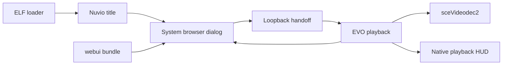
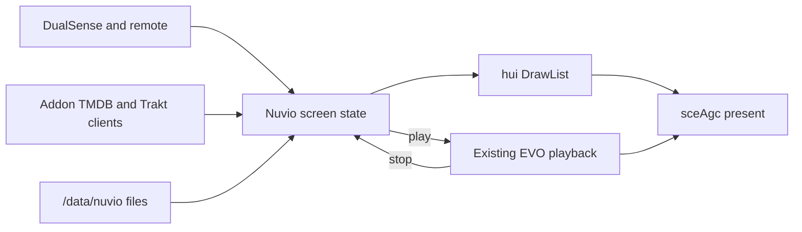

# Native UI feasibility

This page records a feasibility study. It does not change the browser, the player, or the build.

The recommendation is to proceed with a proof of concept first. Do not start a full migration. The proof must show a Nuvio-styled native screen on firmware 12.70 before any later phase removes the browser.

Labels mean:

- [VERIFIED]: a source file, a pinned revision, or a recorded test supports the claim.
- [INFERENCE]: the claim follows from those sources, but this title has not demonstrated it.
- [UNKNOWN]: the claim needs more source inspection or a hardware test.

## 1. Executive summary

Nuvio Pro is a native EVO title that opens the PS5 system browser for the Nuvio TV application. EVO still decodes video, plays audio, and draws the playback interface. The browser is a system dialog, not the video renderer.

[VERIFIED] The pinned EVO revision already has a native interface kit. That kit draws shelves, detail pages, settings, dialogs, toasts, and loading cards. EVO presents the kit through `sceAgc`. RmlUi remains for downloaded provider bundles and for glyphs the kit cannot draw.

[VERIFIED] The Nuvio TV behaviour that users see is a generated JavaScript bundle. The adapter calls the DOM, `localStorage`, and the page router. An embedded script engine without those browser objects cannot run that bundle.

A native Nuvio UI is technically possible because the renderer, the controller path, the keyboard, and the player already exist. Matching the current Nuvio TV look is not proven. Replacing the account, catalogue, addon, and profile behaviour is a new application, not a renderer swap.

### Direct answers

1. The browsing UI can leave WebKit. The system browser is a dialog that the title opens and closes. The catalogue and account logic still have to be rewritten.
2. The same visual quality is possible only as a new theme on the existing kit. The kit does not import Nuvio CSS. A console comparison is still required.
3. The best fit is the homebrew UI kit already vendored by the pinned EVO revision, drawn through EVO's `sceAgc` batch. A new framework, Dear ImGui, or a second OpenGL stack is a poor fit.
4. The existing JavaScript cannot be reused as the application. Reuse the network protocols and the playback policies already moved into native code.
5. The EVO decoder and playback services can stay. The browser open, close, route snapshot, and loopback handoff cannot stay unchanged.
6. The largest blockers are the missing layout engine, an unmeasured poster cache, browser-owned account storage, and the loss of upstream Nuvio TV updates.
7. The proof of concept is one themed shelf, one detail card, and one playback handoff. Full parity reimplements the Nuvio TV application.
8. A full rewrite is not worth its cost today. The browser already is the Nuvio interface. Native UI removes dialog switching. It also freezes the project off upstream UI updates.

## 2. Current architecture analysis

[VERIFIED] [Architecture](ARCHITECTURE.md) separates the system browser from the native player. The title serves `webui/` on loopback. The browser loads that origin. Playback closes the browser. The player opens the browser again when playback ends.

The two lifetimes matter. Search text shows the split. Earlier native IME prototypes used a browser-close state machine before Nuvio moved to in-browser keyboard entry. Simultaneous browser and IME display failed in the recorded comparison. See [Architecture](ARCHITECTURE.md#controller-and-screen-state) and [scripts/ps5-text-input.js](../scripts/ps5-text-input.js).

[VERIFIED] The product title identity is `PPSA99996` in `sce_sys/param.json` on
`main`. That file sets the name, category, and content version. It does not
select a UI toolkit. The Phase 1 PoC branch temporarily uses `PPSA99995` and
`/data/nuvio-poc` for side-by-side installs. See [Native UI proof](NATIVE_UI_POC.md).

[VERIFIED] Persistent browser state is a JSON file under `/data/nuvio/webui/`. Playback recovery uses two checksummed files beside that snapshot. Native addon data uses `/data/nuvio/addons.json`. See [Architecture](ARCHITECTURE.md#persistent-files).

### What already runs natively

[VERIFIED] EVO v0.13.5, commit `f6e43e65`, is the player pin in [Sources](SOURCES.md). Its own interface document, `docs/ui/hui-kit.md` at that commit, describes this chain:

- Screen code updates parameters.
- `evo_rmlui_render_*` tries the homebrew UI kit first.
- `ui_kit` records a `hui::gfx::DrawList`.
- `hui_agc_batch.cpp` draws that list with `sceAgc` and the kit's SDF shader.
- RmlUi draws the screen only when the kit declines it.

[VERIFIED] Nuvio already uses that draw list for playback cards. [scripts/ps5-general-hui.cpp](../scripts/ps5-general-hui.cpp) records text, bordered cards, and button hints. [scripts/polish.py](../scripts/polish.py) prefers this HUD and keeps RmlUi for captions the kit fonts cannot draw.

[VERIFIED] The same EVO document lists native screens for Home, lists, a file browser, Settings, the player OSD, dialogs, toasts, and provider shelves. Provider detail has overview, cast, details, show, and loading fixtures. Focus stays in `core/`. The draw function only reads state.

[INFERENCE] A Nuvio shell can be another screen family on that chain. The title would stop opening the browser for browsing. Playback would stay on the current player services.

## 3. Frontend dependency and browser API audit

[VERIFIED] The repository does not contain the Nuvio TV application. [scripts/build.py](../scripts/build.py) downloads the pin `25b984f`, installs Node packages, and runs the upstream build. The builder then copies the bundle into `webui/`.

[VERIFIED] [Validation](VALIDATION.md) records one built bundle at 3,180,782 bytes and one stylesheet at 545,529 bytes. Later adapter scripts add more code. The current bundle size is [UNKNOWN] until the next build.

The adapter shows which browser objects the UI needs:

| Layer | Evidence | Browser tie |
|---|---|---|
| Presentation | Generated HTML, CSS, and DOM nodes | The page is the UI |
| Navigation | [scripts/ps5-navigation.js](../scripts/ps5-navigation.js) calls `Router` and `document` | Route and focus live in the page |
| Input | [scripts/ps5-input.js](../scripts/ps5-input.js) listens on `document` | The browser owns the pointer and D-pad keys |
| Storage | `localStorage` and the loopback storage hook | Account state is browser state |
| Data | `fetch` from the page to addons, TMDB, and Trakt | The page starts those requests |
| Auth | QR and sign-in routes in the adapter | The page renders the login flow |
| Images | Poster nodes in the page | The browser decodes them |
| Playback | The page posts to `/evo/` and then closes | The handoff exists because the page is separate |

[VERIFIED] The navigation adapter names these routes: `profileSelection`, `authQrSignIn`, `authSignIn`, `serverConnection`, `syncCode`, `experienceModeSelection`, `essentialAddonSetup`, `search`, `folderDetail`, and `player`. It also calls home, poster, episode, season, profile, and Continue Watching actions. The full route table is inside the generated bundle. Routes that the adapter does not name are [UNKNOWN] from this repository alone.

[VERIFIED] [scripts/ps5-general.js](../scripts/ps5-general.js) reads `ProfileManager`, addon URLs, and Trakt identifiers before playback. It posts a bounded presentation record to the title. The native player never runs the page's trailer pipeline.

### Split by responsibility

| Area | Reuse | Rewrite |
|---|---|---|
| Presentation | Use the current CSS as a visual reference | Draw every screen with the native kit |
| Navigation and state | Keep the route names and back behaviour | Replace the DOM router and focus |
| Business logic | Keep protocols and rules already copied into C | Replace catalogue, addon, and account flow |
| Authentication | Keep the QR and token endpoints | Replace the page that drives them |
| Metadata and images | Keep TMDB and addon field meanings | Decode images into textures |
| Playback | Keep EVO decode, audio, and OSD | Call the player without closing a browser |
| Storage | Keep `/data/nuvio` files | Replace `localStorage` as the source of truth |
| Console integration | Keep pad, IME, and decoder calls | Delete the browser input bridge |

[VERIFIED] The public login fields come from the pinned official TV package. [Architecture](ARCHITECTURE.md#browser-ui-hosting) says the build copies selected TMDB and Trakt fields, not owner account state.

[INFERENCE] A native client can call the same public endpoints. The request shapes still have to be taken from the generated frontend or from upstream source. This study did not extract those clients.

## 4. Native PS5 API and framework research

This port uses the PS5 payload SDK v0.43 and pacbrew target libraries. It does not include the official Sony application SDK. Claims below come from this repository and the pinned public revisions. They are not official Sony documentation.

### APIs this title already uses

| API | Evidence | Role |
|---|---|---|
| `sceWebBrowserDialog*` | [scripts/build.py](../scripts/build.py) | Opens the system browser |
| `sceImeDialog*` | [scripts/polish.py](../scripts/polish.py) | System keyboard |
| `scePadOpen`, `scePadReadState`, `scePadClose` | [scripts/native_remote.py](../scripts/native_remote.py) | DualSense and remote input |
| `sceVideodec2` | [Architecture](ARCHITECTURE.md) | Hardware video decode |
| `sceAgc` | Pinned EVO `docs/ui/hui-kit.md` | UI and playback presentation |
| `libSceNet` | [Architecture](ARCHITECTURE.md#permissions-and-firmware) | Title networking |

[VERIFIED] The import table also names `libScePosixForWebKit.prx`. [Architecture](ARCHITECTURE.md#permissions-and-firmware) treats that import as a linked interface. It does not show an embedded browser. The browsing UI is the system dialog.

[VERIFIED] [scripts/polish.py](../scripts/polish.py) notes an undocumented `animation` field on the browser dialog parameters. The adapter does not treat that field as a UI toolkit.

[UNKNOWN] Other system UI surfaces, including any private widget framework, are not established by this SDK pin. This study does not recommend them.

### Homebrew UI kit

[VERIFIED] `deps.lock` pins `ps5-homebrew-ui` at `47f4b986`. [Sources](SOURCES.md) records the GPL-3.0-or-later licence. The project licence is the same family, so the kit can stay in this title.

[VERIFIED] The kit architecture at that commit says the standalone app is immediate mode. Each frame records shapes. One shader draws them. There is no widget tree, no layout engine, and no script layer. The standalone app presents with OpenGL through `ps5-opengl`.

[VERIFIED] EVO's kit document says the opposite present path for this player. EVO does not compile the kit's OpenGL files. `hui_agc_batch.cpp` draws the same `DrawList` with `sceAgc`. HDR10 uses a second pipe. The kit uses baked SDF font atlases, with HarfBuzz and FreeType for complex scripts.

[VERIFIED] The kit's own tour report says a PS5 ran its 21 sample designs at 3840x2160 on 2026-10-02. The report gives about 16.7 ms average frame time. That run is not a Nuvio catalogue. Nuvio performance on that kit is [UNKNOWN].

[VERIFIED] EVO documents poster shelves, a 1920x1080 virtual canvas, corner radii of 16, 20, and 32, and a host preview command, `tools/hui_preview.sh`. Those radii are EVO page metrics. They are not Nuvio measurements.

### Other candidates

| Candidate | PS5 status in this pin | Fit for Nuvio |
|---|---|---|
| RmlUi 6.2 | Linked. CPU previews exist. Console HUD is the fallback | Poor primary shell |
| Dear ImGui | Used upstream only as an OpenGL smoke title | Rejected look and model |
| NanoVG | Not in the pin | New backend, no gain |
| SDL UI | A PS5 SDL tree documents pad input. This title does not link SDL | Second stack |
| New `sceAgc` widgets | The batch and shader already exist | Duplicates the kit |
| Official Sony widgets | Not in the payload SDK used here | Do not depend on them |

[VERIFIED] [Validation](VALIDATION.md) records RmlUi 6.2 at commit `2230d1a6`, with host frames from its CPU rasterizer. Those frames show playback prompts. They do not show a Nuvio home screen. [Architecture](ARCHITECTURE.md) says host RmlUi renders do not validate the console HUD.

[INFERENCE] RmlUi's RCSS subset cannot absorb the 545 KB Nuvio stylesheet as a build input. A Nuvio RmlUi skin would still be a rewrite. The existing CPU fallback is the wrong primary path for large poster grids.

[VERIFIED] Upstream EVO issue 77 describes an OpenGL migration and an ImGui smoke title. The pinned player document still says EVO has no OpenGL in the title build. This study does not move Nuvio onto that migration.

## 5. Comparison of architectural alternatives

### Option 1: fully custom native UI

Build a new layout engine, text renderer, image cache, and focus model on `sceAgc`.

The title would own every layer. It would not inherit EVO screen code. The SDF shader, font atlases, pad reader, and present loop would be written again or copied without the kit's tests.

[INFERENCE] Memory and frame time could match the kit, because the pixels would use the same GPU. The cost is the framework, not the look. EVO already paid that cost.

Major risk: a second UI stack beside the playback HUD. Every focus, clip, and HDR bug returns.

Maintenance: this repository would own a toolkit that upstream EVO already maintains.

### Option 2: adapt the existing kit

Add Nuvio screens beside EVO's screens. Use `DrawList`, the `sceAgc` batch, the baked fonts, and the existing focus pattern. Theme the metrics to Nuvio instead of EVO's page chrome.

Reusable code: playback, OSD, pad, IME, progress files, subtitle handoff, and the kit's shelves, dialogs, toasts, and skeletons.

Rewritten code: Nuvio routes, account storage, addon and catalogue clients, image cache, and the visual theme.

Build complexity stays on the current EVO title build. The proof can add one screen the way `hui-kit.md` already describes: a class, two bridge functions, a makefile entry, and a host fixture.

[INFERENCE] Frame cost for a modest shelf should resemble EVO's existing provider shelves. A large unvirtualized poster grid is a separate risk. See the performance section.

Maintenance follows EVO's kit. A kit update can still break Nuvio anchors, as the current playback patches already can.

### Option 3: native shell plus a script runtime

Keep a native renderer and input layer. Run the Nuvio JavaScript in an engine that is not WebKit.

[VERIFIED] The bundle and the adapter call `document`, `localStorage`, `fetch`, CSS classes, and `Router`. A bare engine does not supply those objects. A compatibility layer that supplies them is a browser.

[INFERENCE] Splitting a headless core out of upstream Nuvio would be a permanent fork. This port already patches generated files at fixed anchors. Those anchors break when the upstream file moves. A deeper split breaks more often.

This option does not preserve the current script with less work. It adds an engine, a missing DOM, and the same native UI.

### Comparison

| Topic | Custom UI | Existing kit | Script runtime |
|---|---|---|---|
| Renderer | New | `sceAgc` batch already in EVO | Still needs a renderer |
| Nuvio look | New theme | New theme | New theme, plus a DOM |
| Business logic | Rewrite | Rewrite | Rewrite or a DOM shim |
| Player | Can call EVO | Can call EVO | Can call EVO |
| Build | New stack | Current title build | Current build plus an engine |
| Memory | New cache design | New cache design | Engine plus cache |
| Main risk | Duplicate toolkit | Visual parity and data rewrite | Hidden browser |
| Maintenance | This repo owns the toolkit | Follow the EVO kit | Fork upstream Nuvio |

## 6. Recommended architecture

Use option 2. Keep the EVO playback process. Replace the system browser with Nuvio screens on the existing `DrawList` and `sceAgc` path. Leave RmlUi as the glyph and provider-bundle fallback it already is.

The browser dialog, the loopback UI server, and the DOM input bridge remain until the proof and the later parity work pass. The proof must not delete them.

[INFERENCE] In-process screens can call `PlaybackController` directly. The current `/evo/presentation`, `/evo/progress`, and `/evo/subtitles` posts exist because the browser is another document. The native side of those posts can remain the contract during migration. The HTTP hop can go away after the caller is in-process.

Search should use `sceImeDialog` on the native field. The current failure mode is the overlap with the browser dialog. A native screen does not have that overlap. The kit's on-screen keyboard can remain a fallback. The current adapter does not use a virtual keyboard when IME fails. A hardware test of a native field must decide if Nuvio needs that fallback. That result is [UNKNOWN].

## 7. Proposed component system

The kit has no layout engine. Each screen computes rectangles on a 1920x1080 canvas and records shapes. Components in this design are screen objects with `set`, `update`, `draw`, and `focus`. That matches the EVO screen pattern in `hui-kit.md`.

Nuvio CSS is the measurement source for colour, type size, spacing, poster size, radius, and focus treatment. [UNKNOWN] Those tokens are not extracted yet. The built stylesheet is the place to measure them. EVO's 16, 20, and 32 radii are not the Nuvio values.

| Nuvio surface | Native shape | Kit support |
|---|---|---|
| App shell and sidebar | Fixed rail plus a content frame | EVO already draws a rail |
| Horizontal carousel | A virtualized row of poster rectangles | Provider shelves exist |
| Poster card | Image, title, focus ring, hold menu | Poster tiles exist |
| Backdrop hero | Large image, gradient, title, actions | Home hero is a documented exception |
| Detail panel | Poster, metadata, actions, related row | Detail fixtures exist |
| Episode list and seasons | Rows and a season control | Show detail exists. Exact rows are [INFERENCE] |
| Continue Watching card | Progress bar on a poster | New composition of existing pieces |
| Search | Text field plus results | IME plus a list |
| Profiles | A row of profile cards and a PIN gate | New screen |
| Addon manager | A list with status and actions | New screen |
| Settings | Sections, toggles, and choices | Settings screens exist |
| Modal and context menu | Focus-trapped dialog | Dialogs exist |
| Loading skeleton | Placeholder cards | Documented on provider shelves |
| Toast, empty, and error | Small status surfaces | Toasts exist. Empty copies are new |

[INFERENCE] Springs in the kit can cover focus motion, row entrance, and panel transitions. Frame-accurate copies of every Nuvio CSS animation are [UNKNOWN]. The goal is the same hierarchy and timing character, not a line-by-line CSS port.

Theme data should be one struct: colours, type sizes, spacing, radii, poster size, and focus-ring width. Screens read that struct. They do not hard-code a second palette beside playback.

## 8. Functionality compatibility matrix

| Feature | Existing implementation | Native requirement |
|---|---|---|
| Addon management | Browser UI and `/data/nuvio/addons.json` | Preserve the file and replace the UI |
| Authentication and QR login | Browser routes and copied public client fields | Preserve the endpoints and replace the UI |
| Profiles and PIN | Browser profile routes and browser state | Preserve the gate before progress import |
| Catalogues | Browser data layer and folder screens | Preserve addon results in native lists |
| TMDB metadata | Browser requests under profile settings | Preserve the same profile switch |
| Trakt | Browser requests and presentation identifiers | Preserve sync behaviour outside playback |
| Search | Browser field plus IME after the browser closes | Native field and IME without a browser close |
| Poster and backdrop images | Browser image decode | Texture cache and eviction |
| Movie and series details | Browser detail route | Native detail screen |
| Seasons and episodes | Browser detail actions | Native lists and hold menus |
| Stream selection | Browser picker and manual-selection override | Preserve the picker and the override |
| Playback | EVO player and `sceVideodec2` | Keep the player |
| Resume and progress | Native checkpoint plus browser import | Keep the checkpoint and the profile gate |
| Skip and next episode | Browser lookup, then native prompts | Keep the native prompts and the handoff rules |
| Subtitles and audio choice | Browser policy posted to `/evo/subtitles` | Keep the native picker and the policy |
| Player settings | EVO native OSD | Keep the OSD |
| Playback presentation | Bounded `/evo/presentation` post | Keep the same text and policy limits |
| Persistent settings | Browser state and `/data/nuvio` | One native store, with a migration from the JSON snapshot |
| Controller navigation | DOM bridge over `/evo/controller` | Direct pad reads in the title |
| TV remote | Native receiver, suspended while the browser owns input | Keep the receiver during native screens |
| Loading and errors | Browser screens and native loading artwork | Native skeletons and the existing playback loading controls |
| Parental and recommendation cards | Captured text, drawn by both HUDs | Keep the native cards |
| Speed test | Native worker and browser status | Keep the worker. Replace only the status UI |
| Text entry | `sceImeDialog` around the browser dialog | `sceImeDialog` on the native field |

[VERIFIED] The progress bridge refuses another profile's checkpoint and does not restart playback by itself. A native shell must keep that gate. See [Architecture](ARCHITECTURE.md#controller-and-screen-state).

[VERIFIED] Live Trakt or Simkl scrobbling is not part of the native progress bridge. A native UI must not claim that feature unless new work adds it.

[INFERENCE] EVO provider shelves can display poster rows for media servers. They do not replace Nuvio profiles, QR login, or the Nuvio addon manager. Those remain Nuvio screens.

## 9. Performance and memory considerations

[VERIFIED] The pinned EVO README credits a 1 GiB flexible-memory change in the app module. Nuvio's `param.json` does not set a memory budget. [INFERENCE] The Nuvio title inherits EVO's heap unless a patch removes it. This study found no such patch. [UNKNOWN] This study did not measure the free space beside playback buffers.

[VERIFIED] Today's poster decode happens in the system browser, which is another process. A native UI moves those textures into the title heap. That is the main new memory cost.

[INFERENCE] The draw list can show a row of posters at playback-HUD cost if the row is small and the textures are already decoded. Catalogue screens need a window: decode the focused row and its neighbours, and evict textures outside that window. A full catalogue as live textures is the failure mode to avoid.

[VERIFIED] EVO already moves some provider work onto a worker and draws a busy card on the UI thread. Metadata and image fetches should follow that split. The draw function should only read finished state.

[UNKNOWN] JPEG and PNG decode cost on this title, the texture limit of the `sceAgc` batch, and long-run behaviour with a large cache are not measured. The proof of concept is the place to measure them.

[INFERENCE] Native UI can avoid the browser's full document style and layout pass. It can also waste that gain with too many off-screen images. Virtualization matters more than the choice between the kit and a new renderer.

[VERIFIED] The kit tour's 60 frame report does not transfer to Nuvio. Nuvio rows are network images of unbounded catalogue size. Treat that report as evidence that the renderer can hold 60 frames for its own sample designs.

Audio during browsing is a small risk. Playback audio already has an owner. UI sounds exist in the kit. Nuvio browsing is mostly silent. [INFERENCE] Leave UI sound off until the owner accepts the look, so the proof does not change audio behaviour.

## 10. Risks, unknowns, and technical blockers

1. Visual parity is unproven. A native shelf can be polished and still fail to look like Nuvio TV.
2. The kit computes rectangles in code. Nuvio's CSS layout will not transfer automatically.
3. Account, profile, addon, and catalogue code is in the generated bundle. The native title does not contain it.
4. Browser state under `/data/nuvio/webui/` has no native schema in this study. A migration can lose profiles if it guesses the JSON.
5. Poster cache size, decode time, and eviction are [UNKNOWN] on hardware.
6. Complex script coverage depends on the kit fallback fonts and optional Noto files. Search and titles in some languages remain a hardware check.
7. Upstream Nuvio TV updates would no longer arrive as a rebuilt bundle. Each UI change becomes native work.
8. EVO kit updates can move the bridge anchors that Nuvio patches.
9. The OpenGL migration in upstream EVO is not this pin's present path. Building that stack into Nuvio would add a second renderer.
10. Firmware 12.70 must still show the new screens. Source inspection does not establish console execution.
11. HDR scanout changes the UI pipe. A Nuvio theme must be checked in both SDR and HDR, because playback can leave the scanout in HDR.
12. Removing the browser before parity removes the only complete Nuvio UI.

No item here is a reason to ignore the proof. Items 1, 4, and 5 are reasons to stop if the proof fails.

## 11. Proposed migration roadmap

The phases are conditional. Phase 1 is the only committed next step after the owner accepts this report. Later phases wait for the gate in the next section.

1. Prove one native Nuvio shelf, detail card, and playback handoff. Leave the browser in the title.
2. Measure Nuvio tokens from the built stylesheet and record them as one theme struct.
3. Add Home, Discover, Movies, and Series on that theme, with a virtualized image cache.
4. Add details, seasons, episodes, stream choice, and a handoff that does not close a browser.
5. Add Search with `sceImeDialog` on the native field.
6. Design the native account store. Then add profiles, QR login, and addon management.
7. Move Continue Watching and the watchlist onto the existing progress files and profile gate.
8. Compare every matrix row with the browser build. Fix gaps before deletion.
9. Remove `webui/`, the loopback UI server, the browser dialog, and the DOM bridges.
10. Record firmware 12.70 results in [Validation](VALIDATION.md).

Phase 1 blocks every later phase. Phase 2 blocks visual work. Phase 4 depends on phase 3. Phase 6 depends on a written storage map. Phase 9 depends on phase 8 and a passing console test. Phase 10 applies to each phase that runs on hardware, not only to the end.

## 12. Proof-of-concept specification

The proof answers one question: can this title draw a Nuvio-like shelf and open the current player without the system browser.

### In scope

- One screen on the existing `hui` and `sceAgc` path.
- A dark full-frame background, a hero block, and one horizontal poster row.
- Native text for the title and the focused item.
- D-pad or stick movement along the row, with a visible focus ring.
- The row scrolls by moving rectangles, not by drawing an unbounded list.
- A small metadata fetch that can fail without freezing the frame.
- A detail card for the focused item.
- One Play action that starts the existing EVO player and returns to the native card.
- A host frame from the EVO preview path before any console install.
- One firmware 12.70 install after the host frame matches the intended layout.

### Out of scope

- Deleting the browser, `webui/`, or the current handoff.
- Accounts, profiles, addons, Trakt, or the full catalogue.
- A new renderer, a new decoder, or a firmware change.
- Pixel-perfect parity with every Nuvio screen. The proof targets one screen's identity: dark theme, poster shape, type hierarchy, and focus.

### Pass and fail

Pass requires all of these:

- The host frame shows the hero, at least one decoded poster, readable text, and a focus ring.
- Controller movement changes the focused poster and moves the row when needed.
- A failed metadata request leaves a visible error or empty state and a live frame.
- Play starts the current player. Stop returns to the same card.
- The owner can put the console frame beside the current Nuvio home and judge the identity.

Fail and stop in three cases. The poster path cannot keep a small row smooth. Text is not readable at 1080p and 4K. The owner rejects the visual identity. In that case the browser remains the Nuvio UI.

## 13. Estimated development complexity and effort

This section describes scope. It does not give a calendar estimate.

The proof is one screen class, one theme struct, a bounded image decode, and one call into the current player. EVO's kit document already lists the mechanical steps for a new screen. The unknown work is the theme and the image path, not a new GPU backend.

Full parity is a different size. The recorded Nuvio script bundle is about 3.1 MB, and the stylesheet is about 545 KB. The native port would replace that presentation and the account, catalogue, and addon flow. The playback policies already in C are the smaller part. This is larger than the current browser-adapter port.

The ongoing cost is also higher. A browser build can take an upstream Nuvio TV revision and replay the adapter. A native UI takes each visual or catalogue change as new native work. That cost continues after the first parity pass.

### Recommendation

Proceed with the proof of concept first. Do not proceed with a full migration on this report alone.

The renderer problem is largely solved inside the pinned player. The product problem is not. Nuvio TV's look and its account logic are still the browser application. A small native screen can show whether the kit can carry that look. If it cannot, further native UI work is the wrong spend. Improvements to the current browser then remain the better path.

Phase 1 implementation notes and host-preview steps are in [Native UI proof](NATIVE_UI_POC.md).

## 14. Sources and references

Repository files:

- [docs/ARCHITECTURE.md](ARCHITECTURE.md)
- [docs/SOURCES.md](SOURCES.md)
- [docs/VALIDATION.md](VALIDATION.md)
- [docs/BUILD.md](BUILD.md)
- [deps.lock](../deps.lock)
- [sce_sys/param.json](../sce_sys/param.json)
- [scripts/build.py](../scripts/build.py)
- [scripts/polish.py](../scripts/polish.py)
- [scripts/ps5-input.js](../scripts/ps5-input.js)
- [scripts/ps5-navigation.js](../scripts/ps5-navigation.js)
- [scripts/ps5-general.js](../scripts/ps5-general.js)
- [scripts/ps5-general-hui.cpp](../scripts/ps5-general-hui.cpp)
- [scripts/ps5-text-input.js](../scripts/ps5-text-input.js)
- [scripts/native_remote.py](../scripts/native_remote.py)
- [docs/NATIVE_UI_POC.md](NATIVE_UI_POC.md)
- [scripts/native_ui_poc/](../scripts/native_ui_poc/)
- [scripts/native_ui_poc_preview.sh](../scripts/native_ui_poc_preview.sh)

Pinned revisions, inspected 2026-11-10:

- EVO Player `f6e43e6561796630673f1e20eb1eb67d6428514c`, including `README.md` and `docs/ui/hui-kit.md`
- `ps5-homebrew-ui` `47f4b9868c33264716b2e92922b0d2c9d0f2ab0f`, including `README.md` and `docs/ARCHITECTURE.md`
- Nuvio TV `25b984f778e4083dc6c2e768fdb5fcf46012e8b7`
- Payload SDK v0.43 and pacbrew v0.39, as recorded in [Sources](SOURCES.md)
- RmlUi 6.2 commit `2230d1a6e8e0848ed87a5761e2a5160b2a175ba4`, as recorded in [Validation](VALIDATION.md)

The EVO and homebrew UI documents are public source at those commits. They are not Sony SDK manuals. Upstream EVO issue 77 is context for the OpenGL migration. It is not a behaviour claim for the pinned Nuvio title.
